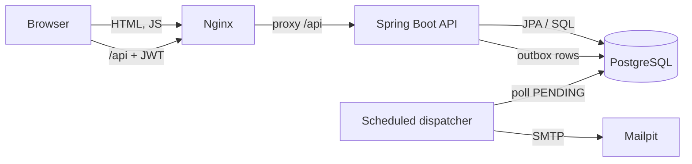

# Taskflow

A small team task tracker, built as a full stack learning project.

- **Frontend:** Angular 22 (standalone components, signals, lazy routes)
- **Backend:** Java 21, Spring Boot 3.5 (Web, Security, Data JPA)
- **Database:** PostgreSQL 16, schema managed by Flyway
- **Ops:** Docker, Docker Compose, GitHub Actions

Users register, create teams, invite members, create projects and move tasks across a board. Owners can manage members and delete projects. Assignments and invitations send emails through a background job.

## Architecture



Inside the API every request passes through the same layers:

```
Security filter (JWT)  ->  Controller  ->  Service (@Transactional, authorization)  ->  Repository  ->  Postgres
                             DTOs in/out      business rules                              entities
```

## Run it

### Everything in Docker

```bash
docker compose up --build
```

| What | URL |
| --- | --- |
| App | http://localhost:4200 |
| API | http://localhost:8080 |
| Sent emails (Mailpit) | http://localhost:8025 |

### Development mode (hot reload)

You need Java 21, Maven, Node 22 and Docker.

```bash
docker compose up db mailpit          # terminal 1: Postgres + fake SMTP
cd backend && mvn spring-boot:run     # terminal 2: API on :8080 (emails are logged to the console)
cd frontend && npm install && npm start   # terminal 3: Angular on :4200, proxies /api to :8080
```

### Tests

```bash
cd backend && mvn verify      # unit tests + integration tests (needs Docker for Testcontainers)
cd frontend && npm test       # Vitest unit tests
```

## API

All endpoints except `/api/auth/**` need `Authorization: Bearer <token>`.

| Method | Path | Who | What |
| --- | --- | --- | --- |
| POST | `/api/auth/register` | anyone | Create an account, returns a token |
| POST | `/api/auth/login` | anyone | Returns a token |
| GET | `/api/me` | signed in | Current user |
| GET, POST | `/api/teams` | signed in | List my teams, create a team |
| GET | `/api/teams/{id}` | member | One team with my role |
| GET | `/api/teams/{id}/members` | member | List members |
| POST | `/api/teams/{id}/members` | owner | Add a registered user by email |
| DELETE | `/api/teams/{id}/members/{userId}` | owner | Remove a member |
| GET, POST | `/api/teams/{id}/projects` | member | List or create projects |
| GET | `/api/projects/{id}` | member | One project |
| DELETE | `/api/projects/{id}` | owner | Delete a project and its tasks |
| GET | `/api/projects/{id}/tasks?status=&assigneeId=` | member | List tasks, optional filters |
| POST | `/api/projects/{id}/tasks` | member | Create a task |
| PUT | `/api/tasks/{id}` | member | Replace a task's fields (checks `version`) |
| PATCH | `/api/tasks/{id}/status` | member | Move a task |
| DELETE | `/api/tasks/{id}` | creator or owner | Delete a task |

Try it with curl:

```bash
TOKEN=$(curl -s localhost:8080/api/auth/register -H 'Content-Type: application/json' \
  -d '{"email":"me@example.com","password":"password123","displayName":"Me"}' | jq -r .token)

curl -s localhost:8080/api/teams -H "Authorization: Bearer $TOKEN" \
  -H 'Content-Type: application/json' -d '{"name":"Platform"}'
```

## Where to find each concept

Read the files in this order. Each one has comments explaining the why.

### Backend (`backend/src/main/java/com/taskflow`)

| Concept | File | What to notice |
| --- | --- | --- |
| REST controller | `task/TaskController.java` | Thin: path variables, query params, `@Valid`, status codes |
| DTOs vs entities | `task/TaskDtos.java` | Records for input and output, entities never leave the service |
| Validation | `auth/AuthDtos.java` | `@NotBlank`, `@Email`, `@Size` on request records |
| Error handling | `common/GlobalExceptionHandler.java` | One `@RestControllerAdvice`, RFC 9457 problem details |
| Dependency injection | any service | Constructor injection, no `@Autowired` fields |
| JPA entities | `task/Task.java`, `team/TeamMember.java` | `LAZY` relations, `EnumType.STRING`, join entity with a role |
| Spring Data repositories | `team/TeamMemberRepository.java` | Derived queries, JPQL, `join fetch` against N+1 |
| Dynamic queries | `task/TaskSpecifications.java` | Composable filters, `@EntityGraph` in `TaskRepository` |
| Transactions | `team/TeamService.java` | `@Transactional`, `readOnly`, two inserts that commit together |
| Optimistic locking | `task/Task.java`, `TaskService.update` | `@Version`, 409 on a stale write |
| Password hashing | `auth/AuthService.java` | BCrypt, same error for unknown user and wrong password |
| JWT auth | `config/SecurityConfig.java`, `auth/TokenService.java` | Stateless filter chain, signing and verifying tokens |
| Authorization | `team/TeamAccess.java` | Role checks in the service layer, 401 vs 403 |
| CORS | `config/SecurityConfig.java` | Allowed origins from configuration |
| Outbox pattern | `notification/NotificationService.java` | Email row written in the business transaction |
| Background job | `notification/NotificationDispatcher.java` | `@Scheduled`, retries, at-least-once delivery |
| Row locking | `notification/NotificationRepository.java` | `FOR UPDATE SKIP LOCKED` as a safe work queue |
| Interfaces and profiles | `notification/EmailSender.java` | Two implementations chosen by `@ConditionalOnProperty` |
| Configuration | `config/AppProperties.java`, `application.yml` | Type-safe properties, environment variable overrides |

### Database (`backend/src/main/resources/db/migration`)

| Concept | File | What to notice |
| --- | --- | --- |
| Migrations | `V1__create_core_tables.sql` | Versioned, run once, never edited after release |
| Schema design | `V1__create_core_tables.sql` | Foreign keys, `on delete cascade` vs `set null`, check constraints |
| Indexes | `V1__create_core_tables.sql` | Composite index for the board query, why `user_id` needs its own |
| Partial index | `V2__create_notifications_outbox.sql` | Index only the `PENDING` rows |

Connect and look around:

```bash
docker compose exec db psql -U taskflow
\d tasks
explain analyze select * from tasks where project_id = 1 and status = 'TODO';
select * from flyway_schema_history;
```

### Tests (`backend/src/test/java/com/taskflow`)

| Concept | File | What to notice |
| --- | --- | --- |
| Unit test | `task/TaskServiceTest.java` | JUnit 5 + Mockito, no Spring, no database |
| Integration test | `ApiIntegrationTest.java` | Real Postgres via Testcontainers, MockMvc through the security filters |

### Frontend (`frontend/src/app`)

| Concept | File | What to notice |
| --- | --- | --- |
| App setup | `app.config.ts` | Standalone providers, no NgModules |
| Lazy routes and guards | `app.routes.ts`, `core/auth.guard.ts` | `loadComponent`, functional guards |
| HTTP interceptor | `core/auth.interceptor.ts` | Attach the token, sign out on 401 |
| Session state | `core/auth.service.ts` | Signals, `computed`, localStorage trade-off |
| API layer | `core/api.service.ts` | Typed `HttpClient` calls, one error formatter |
| Reactive forms | `pages/register.ts` | Validators, typed `getRawValue()` |
| Parallel requests | `pages/team-detail.ts` | `forkJoin`, route param as `input()` |
| Chained requests | `pages/board.ts` | `switchMap`, `computed` columns |
| Optimistic UI | `pages/board.ts` (`move`) | Update first, roll back on error |
| Conflict handling | `pages/board.ts` (`reassign`) | Send `version`, reload on 409 |

### Ops

| Concept | File | What to notice |
| --- | --- | --- |
| Multi-stage images | `backend/Dockerfile`, `frontend/Dockerfile` | Build stage vs runtime stage, layer caching, non-root user |
| Reverse proxy | `frontend/nginx.conf` | `/api` proxy, SPA fallback, cache headers |
| Local stack | `docker-compose.yml` | Health checks, `depends_on`, config through environment |
| CI | `.github/workflows/ci.yml` | Build and test both halves on every push |

## Exercises

Reading code teaches less than changing it. These go from easy to hard, and each one touches every layer.

1. **Task comments.** New table (write `V3__...sql`), entity, repository, endpoints, and a comment list on the task card.
2. **Edit a task.** The `PUT` endpoint exists. Add an edit form in the board for title, description, priority and due date.
3. **Pagination.** Return tasks as a `Page` with `page` and `size` params, and add "load more" in the UI.
4. **Drag and drop.** Replace the Back and Forward buttons with Angular CDK drag and drop.
5. **Refresh tokens.** Short access token plus a refresh token in an HttpOnly cookie. Decide how you handle CSRF.
6. **Overdue reminders.** A second scheduled job that queues an email for tasks past their due date, once per task.
7. **Method security.** Replace some `TeamAccess` calls with `@PreAuthorize` and a custom bean, then compare the two styles.
8. **Caching.** Add Redis to Compose and cache the member list. Work out when it must be evicted.
9. **Upgrade.** Move to Spring Boot 4 and fix what breaks. The tests tell you when you are done.
10. **Deploy.** Push the images to a registry and run the stack on AWS (ECS + RDS) or Fly.io, with the JWT secret in a secret store.

## Deliberate simplifications

Things a production system would do differently, so you can explain them in an interview:

- The JWT lives in `localStorage` and there is no refresh token or logout on the server.
- A user must already be registered before an owner can add them. There are no invitation links.
- Non-members get `403` for a team that exists, which reveals that the id is valid. Some APIs return `404` instead.
- There is no rate limiting on login.
- The outbox is polled every 5 seconds. Larger systems use a message broker or change data capture.
